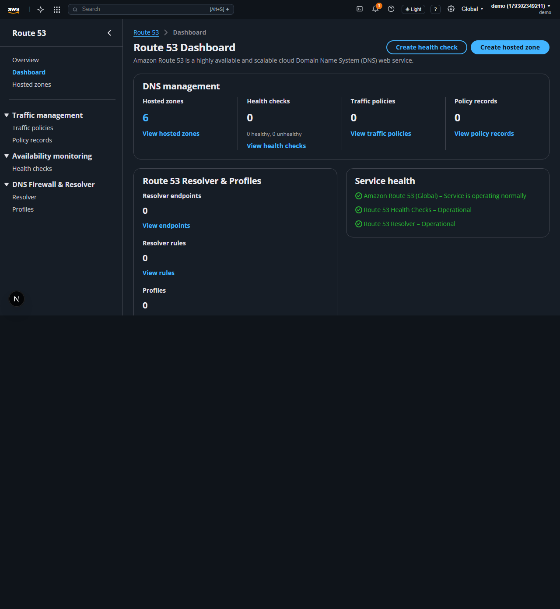
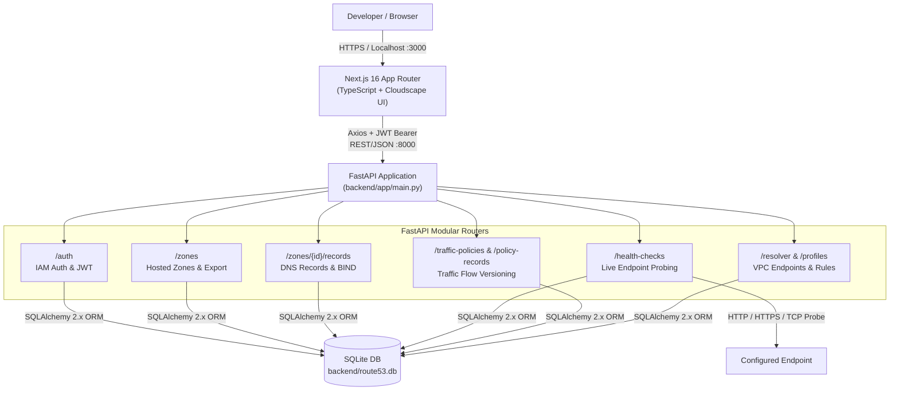
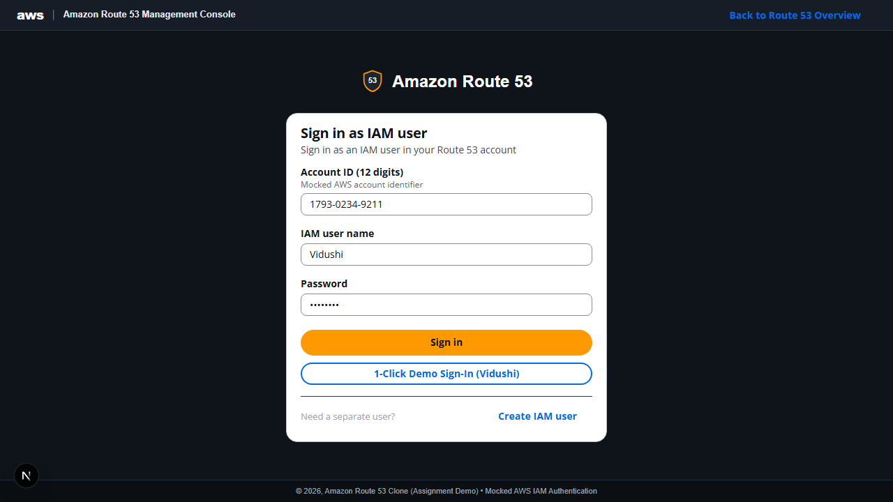
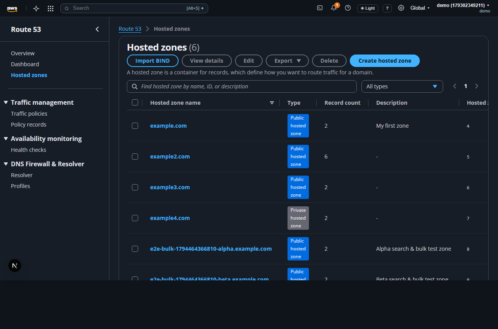
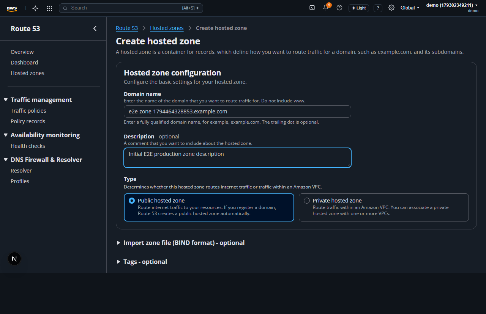
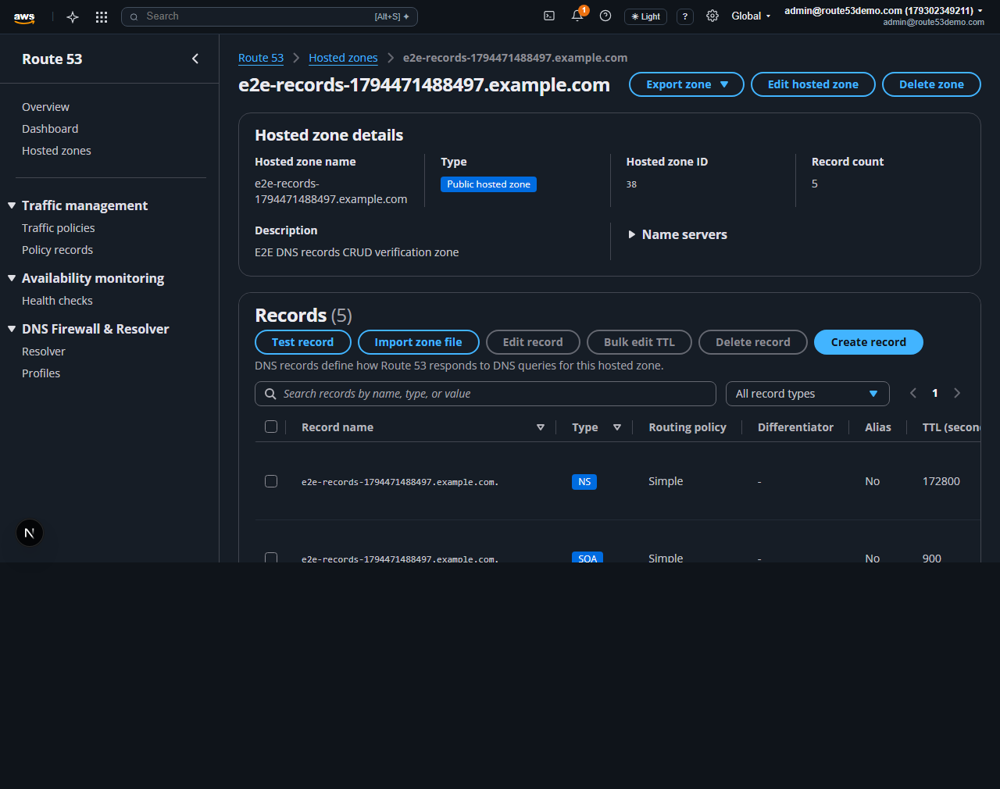
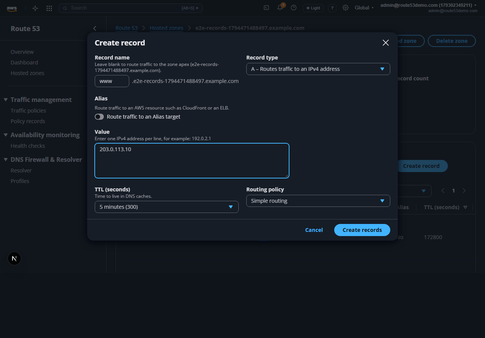
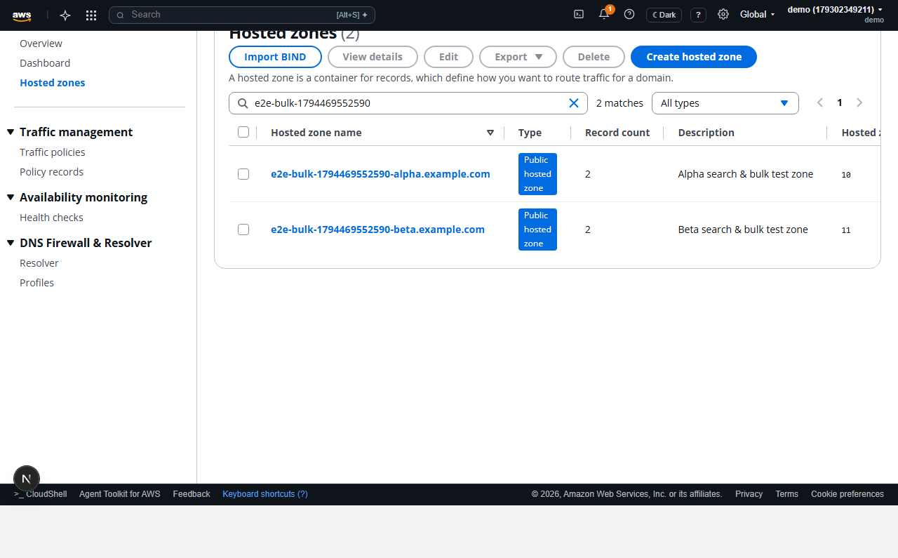
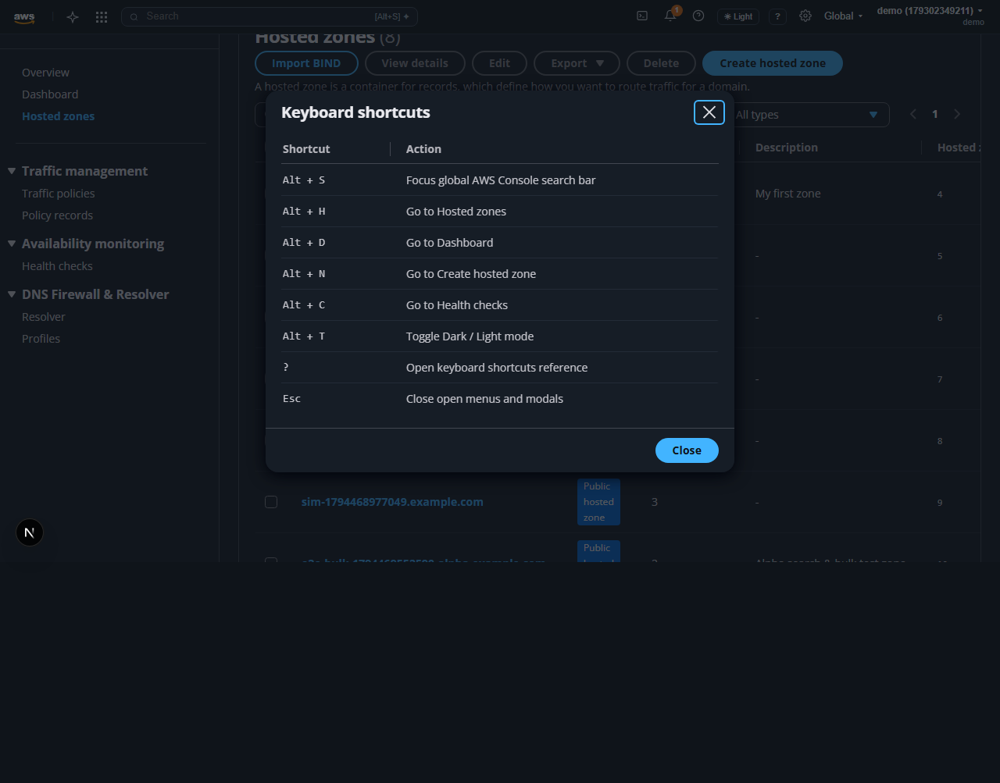

# AWS Route 53 Clone

A full-stack clone of the **Amazon Route 53 Management Console** built with **Next.js 16 (TypeScript)**, **AWS Cloudscape Design System**, **FastAPI**, and **SQLite**. It recreates the dark-mode AWS Route 53 console experience, end-to-end Hosted Zone and DNS Record management, routing policies, health checks, traffic policies, VPC resolver endpoints/rules, profiles, mocked AWS IAM authentication, BIND zone file import/export, bulk actions, keyboard shortcuts, and Cloudscape Flashbar notifications.



---

## Table of Contents

1. [Live Demo & Pre-Configured Credentials](#live-demo--pre-configured-credentials)
2. [Features](#features)
3. [System Architecture](#system-architecture)
4. [UI Walkthrough & Screenshots](#ui-walkthrough--screenshots)
5. [Project File Structure](#project-file-structure)
6. [Database Schema](#database-schema)
7. [API Reference](#api-reference)
8. [Local Setup & Database Seeding](#local-setup--database-seeding)
9. [Running Tests](#running-tests)
10. [Additional Documentation](#additional-documentation)

---

## Live Demo & Pre-Configured Credentials

| Resource | URL / Value | Notes |
| :--- | :--- | :--- |
| **Live Demo URL** | [https://aws-route53-clone-blue.vercel.app](https://aws-route53-clone-blue.vercel.app) | Deployed Next.js console on Vercel |
| **Local Console URL** | `http://localhost:3000` | Route 53 Overview landing page |
| **Local IAM Sign-In** | `http://localhost:3000/login` | Supports **1-Click Demo Sign-In (`Vidushi`)** |
| **Backend API & Swagger** | `http://localhost:8000/docs` | Interactive OpenAPI 3.1 documentation |

### Pre-Configured Demo Login Credentials

| Account | Username | Password | IAM Account ID | Provisioning |
| :--- | :--- | :--- | :--- | :--- |
| **1-Click Demo User** | `Vidushi` | `demo1234` | `1793-0234-9211` | Seeded by `backend/seed.py` & auto-provisioned on `POST /auth/demo` |
| **Administrator** | `admin@route53demo.com` | `AdminDemo123!` | `1793-0234-9211` | Seeded by `backend/seed.py` (8 hosted zones + health checks + policies) |
| **DevOps Engineer** | `devops@route53demo.com` | `DevopsDemo123!` | `1793-0234-9211` | Seeded by `backend/seed.py` (6 hosted zones + health checks + policies) |
| **Read-Only Viewer** | `viewer@route53demo.com` | `ViewerDemo123!` | `1793-0234-9211` | Seeded by `backend/seed.py` (4 hosted zones) |

> [!TIP]
> On the `/login` page, click **1-Click Demo Sign-In (Vidushi)** to authenticate immediately without typing credentials. See [docs/walkthrough.md](docs/walkthrough.md) for a complete page-by-page guide.

---

## Features

### Core Capabilities
- **Mocked AWS IAM Authentication & Session Persistence**: Dark-mode AWS IAM Sign-In & Registration (`/login`) with 12-digit Account ID (`1793-0234-9211`), JWT Bearer token persistence in `localStorage`, automatic `Authorization` header injection, and `401 Unauthorized` session handling.
- **Hosted Zones CRUD (SQLite-backed)**: Search, filter by `Public` / `Private`, paginate, create, edit description, and delete hosted zones, with automatic generation of 4 authoritative `NS` records and an `SOA` apex record on creation.
- **DNS Records CRUD (SQLite-backed)**: Full support for **A, AAAA, CNAME, TXT, MX, NS, PTR, SRV, CAA, SOA** records, search/type filtering, Alias toggle, TTL presets, Health Check association, routing policies (`Simple`, `Weighted`, `Latency`, `Failover`, `Geolocation`, `Multivalue`), and apex `NS`/`SOA` deletion protection.
- **Authentic AWS Route 53 Console UI**: Built on `@cloudscape-design/components` and `@cloudscape-design/global-styles` with `AppLayout`, `SideNavigation`, `BreadcrumbGroup`, `Flashbar`, and `awsui-dark-mode` styling.
- **Extended Route 53 Services**:
  - **Dashboard** (`/dashboard`): Summary metrics across hosted zones, DNS records, health checks, and traffic policies.
  - **Health Checks** (`/health-checks`): Create, execute live endpoint checks, and delete health monitors.
  - **Traffic Policies & Policy Records** (`/traffic-policies`, `/policy-records`): Versioned traffic flow JSON policies bound to hosted zones.
  - **Resolver & Profiles** (`/resolver`, `/profiles`): Inbound/outbound VPC resolver endpoints, forwarding rules, and reusable Route 53 profiles.

### Engineering & UX Enhancements
- **BIND Zone File Import & Export**: Import `$ORIGIN` / `$TTL` BIND files (`POST /zones/{zone_id}/records/import-bind`) and export zones as BIND `.zone` or JSON (`GET /zones/{zone_id}/export?format=bind|json`).
- **Dark & Light Mode Toggle**: Persisted in `localStorage` (accessible from the top console bar, settings menu, or `Alt+T`).
- **Keyboard Shortcuts**: `Alt+S` (global search), `Alt+H` (hosted zones), `Alt+D` (dashboard), `Alt+N` (create zone), `Alt+C` (health checks), `Alt+T` (theme toggle), and `?` (shortcuts help modal).
- **Bulk Operations**: Multi-select checkboxes for bulk zone delete (`POST /zones/bulk-delete`), bulk record delete (`POST /zones/{zone_id}/records/bulk-delete`), bulk TTL updates (`POST /zones/{zone_id}/records/bulk-ttl`), and bulk export.

---

## System Architecture

The application follows a decoupled client-server architecture: the **Next.js 16** frontend renders AWS Cloudscape components and communicates over REST/JSON with the **FastAPI** backend, which enforces JWT authentication and persists state in **SQLite** via **SQLAlchemy ORM**.



For full sequence diagrams, database evolution notes (`run_sqlite_migrations()`), and design trade-offs, see **[docs/architecture.md](docs/architecture.md)**. For a shareable, production-scale multi-region DNS control & data plane HLD, see **[docs/mature-service-hld.md](docs/mature-service-hld.md)**.

---

## UI Walkthrough & Screenshots

All screenshots below are automatically generated by the Playwright E2E suite into `docs/screenshots/`. See **[docs/walkthrough.md](docs/walkthrough.md)** for the full step-by-step user guide.

### 1. Mocked AWS IAM Sign-In (`/login`)


### 2. Route 53 Dashboard (`/dashboard`)


### 3. Hosted Zones Management (`/hosted-zones`)


### 4. Create Hosted Zone Wizard (`/hosted-zones/create`)


### 5. Hosted Zone Details & DNS Records (`/hosted-zones/[zoneId]`)


### 6. Create DNS Record Modal


### 7. Light Mode & Keyboard Shortcuts (`Alt+T` / `?`)
| Light Mode Toggle (`Alt+T`) | Keyboard Shortcuts Modal (`?`) |
| :---: | :---: |
|  |  |

---

## Project File Structure

```text
aws-route53-clone/
├── docs/
│   ├── architecture.md                # HLD diagrams, ER diagram, DB evolution & design decisions
│   ├── api-design.md                  # Complete REST API schemas, status codes & rationale
│   ├── walkthrough.md                 # Page-by-page user walkthrough & demo credentials
│   └── screenshots/                   # Playwright-generated full-page UI screenshots (01–08)
├── backend/                           # FastAPI REST API + SQLite ORM
│   ├── app/
│   │   ├── main.py                    # FastAPI app, CORS, run_sqlite_migrations() & router wiring
│   │   ├── database.py                # SQLAlchemy engine (sqlite:///./route53.db) & get_db
│   │   ├── models.py                  # 9 SQLAlchemy ORM models
│   │   ├── schemas.py                 # Pydantic v2 request/response schemas
│   │   ├── dependencies.py            # JWT Bearer authentication (get_current_user)
│   │   └── routers/
│   │       ├── auth.py                # /auth (register, login, login-json, demo, me)
│   │       ├── zones.py               # /zones (CRUD, domain validation, bulk-delete, export)
│   │       ├── records.py             # /zones/{zone_id}/records (CRUD, BIND import, bulk ops)
│   │       ├── health_checks.py       # /health-checks (CRUD + live probe execution)
│   │       ├── traffic_policies.py    # /traffic-policies & /policy-records
│   │       └── resolver.py            # /resolver/endpoints, /resolver/rules, /profiles
│   ├── tests/
│   │   ├── conftest.py                # Isolated in-memory SQLite + FastAPI TestClient fixtures
│   │   ├── test_api_client.py         # End-to-end API CRUD & edge-case tests
│   │   ├── test_auth.py               # Auth unit/integration tests
│   │   ├── test_zones_and_records.py  # Zones & DNS records tests
│   │   └── test_route53_features.py   # Health checks, traffic policies, resolver & profiles tests
│   ├── create_db.py                   # Standalone SQLite table initialization script
│   ├── seed_demo_user.py              # Standalone seed script for demo admin user
│   └── requirements.txt
└── frontend/                          # Next.js 16 (App Router, TypeScript) + Cloudscape UI
    ├── app/
    │   ├── layout.tsx                 # Global Cloudscape styles & fonts
    │   ├── globals.css                # Dark/Light console header, footer & hero styling
    │   ├── lib/api.ts                 # Axios client, JWT interceptors, domain validators & helpers
    │   ├── components/
    │   │   ├── ClientShell.tsx        # Hydration-safe client wrapper
    │   │   └── ConsoleLayout.tsx      # AWS top bar, SideNavigation, Flashbar, shortcuts, theme
    │   ├── login/page.tsx             # Mocked AWS IAM Sign-In / Register + 1-Click Demo button
    │   ├── page.tsx                   # Route 53 Overview landing page
    │   ├── dashboard/page.tsx         # Route 53 Dashboard metrics & recent zones
    │   ├── hosted-zones/
    │   │   ├── page.tsx               # Hosted zones table (search, filter, edit, bulk actions)
    │   │   ├── create/page.tsx        # Create Public/Private hosted zone wizard
    │   │   └── [zoneId]/page.tsx      # Zone details, DNS records CRUD & BIND import/export
    │   ├── health-checks/page.tsx
    │   ├── traffic-policies/page.tsx
    │   ├── policy-records/page.tsx
    │   ├── resolver/page.tsx
    │   └── profiles/page.tsx
    ├── e2e/                           # Playwright E2E test suites & screenshot capture
    │   ├── helpers.ts
    │   ├── 01-auth-and-dashboard.spec.ts
    │   ├── 02-hosted-zones-lifecycle.spec.ts
    │   ├── 03-dns-records-crud.spec.ts
    │   └── 04-search-bulk-shortcuts-theme.spec.ts
    ├── tests/
    │   ├── api-helpers.test.mts       # Node test runner helper tests
    │   ├── frontend-audit.test.mts    # Accessibility & API trailing-slash audit tests
    │   └── vitest/
    │       ├── helpers.test.ts        # Vitest unit tests (domain validation & formatters)
    │       └── hosted-zones.integration.test.tsx # RTL mocked API integration tests
    ├── playwright.config.ts           # Dual webServer (FastAPI + Next.js) E2E configuration
    ├── vitest.config.ts               # Vitest + jsdom configuration
    └── package.json
```

---

## Database Schema

Managed via SQLAlchemy ORM (`backend/app/models.py`) with startup schema evolution (`run_sqlite_migrations()` in `backend/app/main.py`).

| Table | Purpose | Key Columns |
| :--- | :--- | :--- |
| `users` | Mocked IAM user accounts | `id`, `username` (unique), `hashed_password` (bcrypt), `is_active`, `created_at` |
| `hosted_zones` | Public/Private hosted zones | `id`, `name`, `comment`, `zone_type` (`Public`/`Private`), `vpc_id`, `vpc_region`, `owner_id` (FK -> `users.id`), `created_at` |
| `dns_records` | DNS records within a zone | `id`, `name`, `type`, `ttl`, `value`, `routing_policy`, `weight`, `region`, `failover`, `health_check_id`, `set_identifier`, `is_alias`, `zone_id` (FK -> `hosted_zones.id`), `created_at` |
| `health_checks` | Endpoint health monitors | `id`, `name`, `protocol`, `endpoint`, `port`, `resource_path`, `request_interval`, `failure_threshold`, `status`, `status_reason`, `last_checked_at`, `created_at` |
| `traffic_policies` | Versioned traffic flow JSON policies | `id`, `name`, `version`, `dns_type`, `comment`, `document`, `created_at` |
| `policy_records` | Zone-linked traffic policy records | `id`, `name`, `type`, `ttl`, `hosted_zone_id`, `hosted_zone_name`, `traffic_policy_id`, `traffic_policy_name`, `traffic_policy_version`, `created_at` |
| `resolver_endpoints` | Inbound/Outbound VPC endpoints | `id`, `name`, `direction`, `vpc_id`, `ip_addresses`, `status`, `created_at` |
| `resolver_rules` | Forwarding DNS rules | `id`, `name`, `rule_type`, `domain_name`, `target_ip`, `vpc_id`, `status`, `created_at` |
| `route53_profiles` | Reusable VPC DNS profiles | `id`, `name`, `description`, `status`, `vpc_associations`, `resource_count`, `created_at` |

---

## API Reference

Interactive Swagger / OpenAPI docs are served at `http://localhost:8000/docs`. For full request/response schemas, HTTP status codes, and RESTful design rationale, see **[docs/api-design.md](docs/api-design.md)**.

- **Auth (`/auth`)**: `POST /auth/register`, `POST /auth/login`, `POST /auth/login-json`, `POST /auth/demo`, `GET /auth/me`
- **Hosted Zones (`/zones`)**: `GET /zones/`, `POST /zones/`, `GET /zones/{zone_id}`, `PUT /zones/{zone_id}`, `DELETE /zones/{zone_id}`, `POST /zones/bulk-delete`, `GET /zones/{zone_id}/export`
- **DNS Records (`/zones/{zone_id}/records`)**: `GET`, `POST`, `GET /{record_id}`, `PUT /{record_id}`, `DELETE /{record_id}`, `POST /import-bind`, `POST /bulk-delete`, `POST /bulk-ttl`
- **Supporting Services**: `/health-checks` (CRUD + `POST /{hc_id}/check`), `/traffic-policies` (CRUD + `POST /{policy_id}/version`), `/policy-records` (CRUD), `/resolver/endpoints` (CRUD), `/resolver/rules` (CRUD), `/profiles` (CRUD)

---

## Local Setup & Database Seeding

### Prerequisites
- **Python 3.10+**
- **Node.js 18+** & **npm**

### 1. Backend Setup (FastAPI + SQLite)

```bash
cd backend
python -m venv venv

# Windows PowerShell:
.\venv\Scripts\Activate.ps1
# macOS / Linux:
# source venv/bin/activate

pip install -r requirements.txt
```

### 2. Initialize & Seed the Database

Run the idempotent seeder to populate 4 demo accounts, 28 Public/Private hosted zones, realistic DNS records (`A`, `AAAA`, `CNAME`, `MX`, `TXT`, `NS`, `SRV`, `SOA`), health checks, and traffic policies:

```bash
# From backend/ with venv activated:
python seed.py
```

> [!NOTE]
> Starting the FastAPI server (`uvicorn app.main:app`) also runs `Base.metadata.create_all()`, `run_sqlite_migrations()`, and `seed_database(..., only_if_empty=True)` automatically when the database is empty.

### 3. Start the Backend Server

```bash
# From backend/ with venv activated:
uvicorn app.main:app --reload --port 8000
```

- API base URL: `http://localhost:8000`
- Swagger UI: `http://localhost:8000/docs`

### 4. Frontend Setup & Start (Next.js + Cloudscape)

In a second terminal:

```bash
cd frontend
npm install
npm run dev
```

- Web Console URL: `http://localhost:3000`
- Optional environment variable: set `NEXT_PUBLIC_API_URL=http://localhost:8000` in `frontend/.env.local` when pointing to a remote backend.

---

## Running Tests

### 1. Backend Unit & Integration Tests (`pytest`)

Runs against an isolated in-memory SQLite database via FastAPI `TestClient`:

```bash
cd backend
.\venv\Scripts\python.exe -m pytest tests -v
# macOS / Linux:
# ./venv/bin/python -m pytest tests -v
```

### 2. Frontend Unit & Mocked Integration Tests (`Vitest` + `React Testing Library` + Typecheck)

```bash
cd frontend

# Run Vitest unit & mocked RTL integration tests:
npm run test:unit

# Run TypeScript typecheck + Node test suite (API helpers & accessibility audit):
npm test
```

### 3. End-to-End Tests & Screenshot Generation (`Playwright`)

Playwright automatically launches both the FastAPI backend (`:8000`) and Next.js frontend (`:3000`) via `playwright.config.ts`. Install Chromium once if needed:

```bash
cd frontend
npx playwright install chromium

# Run the full E2E suite (also captures screenshots to docs/screenshots/):
npm run test:e2e

# Regenerate documentation screenshots only:
npm run screenshots

# Open interactive Playwright UI mode:
npm run test:e2e:ui
```

---

## Additional Documentation

- **[System Architecture & ER Diagram](docs/architecture.md)** — HLD Mermaid diagrams, SQLite ER diagram, migrations, and architectural decisions.
- **[Mature Service HLD (Production Scale)](docs/mature-service-hld.md)** — Shareable multi-region Anycast DNS control & data plane HLD, propagation sequence, and scaling trade-offs.
- **[API Design & Reference](docs/api-design.md)** — Endpoint contracts, schemas, status codes, and RESTful design rationale.
- **[User Walkthrough & Demo Guide](docs/walkthrough.md)** — Page-by-page console walkthrough and pre-configured demo credentials.
