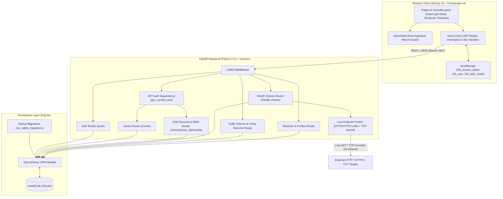
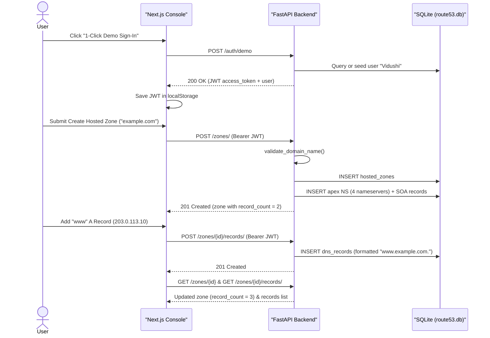
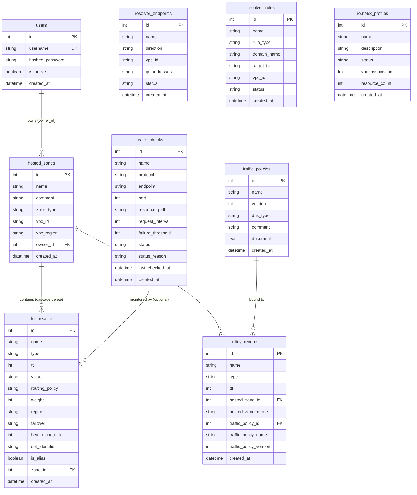

# System Architecture & Database Design

This document describes the High-Level Design (HLD), component interactions, SQLite database schema, schema evolution strategy, and key engineering decisions for the **AWS Route 53 Clone**.

---

## High-Level System Architecture

The application follows a decoupled client–server architecture: a **Next.js (App Router, TypeScript)** console styled with **AWS Cloudscape Design System** communicating over REST/JSON with a **FastAPI** backend backed by **SQLite** via **SQLAlchemy ORM**.

---

## Core Request & Provisioning Flow

When a user creates a Hosted Zone, the backend persists the zone and automatically provisions the 4 authoritative Route 53 `NS` records and the `SOA` apex record in a single workflow, keeping `record_count` accurate across both the zone details view and the parent Hosted Zones table.

---

## SQLite Entity-Relationship Diagram

The database schema is defined in `backend/app/models.py` and stored in `backend/route53.db`.

---

## Database Evolution & Design Decisions

### 1. Lightweight Startup Schema Migrations (`run_sqlite_migrations`)
Because SQLite does not automatically add new columns when SQLAlchemy models evolve, `backend/app/main.py` runs `run_sqlite_migrations()` on startup:
- Calls `models.Base.metadata.create_all(bind=database.engine)` to create any missing tables.
- Inspects existing columns via `PRAGMA table_info(<table>)` and executes `ALTER TABLE ... ADD COLUMN ...` idempotently for newer columns (`hosted_zones.zone_type`, `vpc_id`, `vpc_region`; `dns_records.routing_policy`, `weight`, `region`, `failover`, `health_check_id`, `set_identifier`, `is_alias`).
- Backfills authoritative `NS` and `SOA` records on any pre-existing hosted zones that have zero records.

### 2. Ownership Isolation & Duplicate Zone Disambiguation
- **Owner-scoped Hosted Zones**: Every hosted zone is linked to `users.id` via `owner_id`. `resolve_owned_zone()` ensures users can only read, modify, or delete their own zones.
- **Duplicate Domain Support**: Matching real AWS Route 53 behavior, `hosted_zones.name` is non-unique so a user can host multiple zones for the same domain (for example, a Public zone and a Private VPC zone). The backend accepts lookup by numeric `id` or domain name, and the frontend `hostedZoneHref()` helper appends `?id=<zone_id>` whenever duplicate domain names exist.

### 3. Client-Side Cloudscape Hydration Guard (`ClientShell`)
Cloudscape Design System generates runtime performance-mark IDs and evaluates viewport hooks during mount. Wrapping the Next.js root layout in `ClientShell` defers rendering the Cloudscape component tree until after client hydration, eliminating React SSR hydration mismatch warnings while preserving dark-mode background continuity (`#0f141a`).

### 4. DNS Record Integrity & BIND Interoperability
- **Apex `NS` / `SOA` Protection**: Both single-record `DELETE` and `POST /records/bulk-delete` protect required apex `NS` and `SOA` records from accidental removal (`400 Bad Request` on single delete; skipped count reported on bulk delete).
- **BIND Zone File Parser & Exporter**: Supports `$ORIGIN`, `$TTL`, quoted `TXT` strings, and standard resource record formats for both importing into existing/new zones and exporting zones as `.zone` or `.json`.

