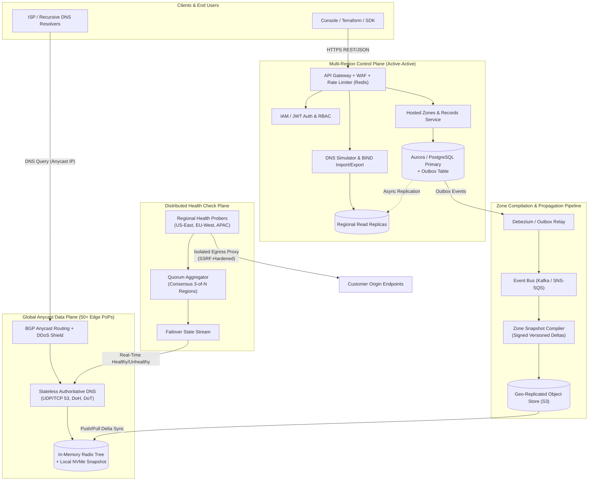

# Mature Service High-Level Design (HLD): Globally Distributed DNS Control & Data Plane

This document presents a **shareable, production-grade High-Level Design (HLD)** illustrating how the **AWS Route 53 Clone** (`Next.js + FastAPI + SQLite`) scales into a **globally distributed, 100%-availability DNS service** comparable to Amazon Route 53.

---

## 1. Design Goals & Non-Functional Requirements

| Dimension | Target | Architectural Mechanism |
| :--- | :--- | :--- |
| **DNS Resolution Latency** | `< 15 ms` p99 globally | BGP Anycast across 50+ Edge PoPs; zero-DB-hop in-memory zone lookup |
| **Data Plane Availability** | `99.999% – 100%` SLA | Decoupled stateless edge DNS servers survive complete Control Plane outage |
| **Propagation SLA** | `< 60 s` global `INSYNC` | Transactional Outbox -> Kafka -> Compiled Zone Delta Snapshots |
| **Control Plane Throughput** | `10,000+ RPS` | Horizontally scaled FastAPI/Go microservices, PgBouncer, Redis rate limiting |
| **Security & Multi-Tenancy** | Strict tenant isolation + DDoS resilience | Anycast SYN/UDP scrubbing, RRL, JWT/IAM RBAC, SSRF-isolated health probers |

---

## 2. Production System Architecture (Control Plane vs. Data Plane)

A mature DNS service strictly separates the **Control Plane** (strongly consistent CRUD APIs, billing, IAM) from the **Data Plane** (ultra-low-latency, read-only, globally replicated DNS query resolution).



---

## 3. Record Change Propagation Flow (`PENDING` -> `INSYNC`)

```mermaid
sequenceDiagram
    autonumber
    actor DevOps as User / Terraform
    participant API as Control Plane API
    participant DB as PostgreSQL + Outbox
    participant Bus as Kafka / Compiler
    participant Edge as Global Anycast PoPs

    DevOps->>API: PUT /zones/{id}/records/{rec_id}
    API->>DB: BEGIN; UPDATE dns_records; INSERT outbox_event (status='PENDING'); COMMIT;
    API-->>DevOps: 200 OK (ChangeId, Status='PENDING')

    DB-->>Bus: Outbox CDC streams record delta
    Bus->>Bus: Validate & compile signed zone delta (serial++)
    Bus->>Edge: Broadcast signed delta + invalidate edge cache
    Edge-->>Bus: PoP ACK (version >= serial)
    Bus->>DB: Mark ChangeId status = 'INSYNC'

    DevOps->>API: GET /changes/{ChangeId}
    API-->>DevOps: 200 OK (Status='INSYNC')
```

---

## 4. Key Architectural Decisions & Trade-Offs

1. **Control Plane / Data Plane Blast-Radius Isolation**:
   - Even if PostgreSQL or the Control Plane API experiences a full regional outage, **Edge PoPs continue serving 100% of DNS queries** from their local signed snapshots and last-known health-check state.
2. **Consensus-Based Distributed Health Checks**:
   - A single prober failure can be a transient local network blip. Mature health checks probe from multiple geographic regions and require quorum agreement (e.g., `failure_threshold` consecutive failures across regions) before triggering DNS failover, while enforcing strict egress ACLs against RFC1918/link-local/metadata IPs.
3. **Transactional Outbox for Propagation Reliability**:
   - Writing DNS mutations and outbox events in the same ACID database transaction prevents dual-write drift between the Control Plane database and Edge DNS snapshots.
4. **Evolution Path from This Repository**:
   - **Current Clone**: `Next.js 16` -> `FastAPI` -> `SQLite` (with `owner_id` multi-tenancy, SSRF-hardened health probes, BIND import/export, and DNS query simulation).
   - **Next Step**: Swap `DATABASE_URL` to PostgreSQL, add Redis for rate limiting + query caching, emit record mutations to an outbox/worker, and front `uvicorn` with an authoritative DNS worker (e.g., CoreDNS / PowerDNS plugin reading compiled snapshots).

