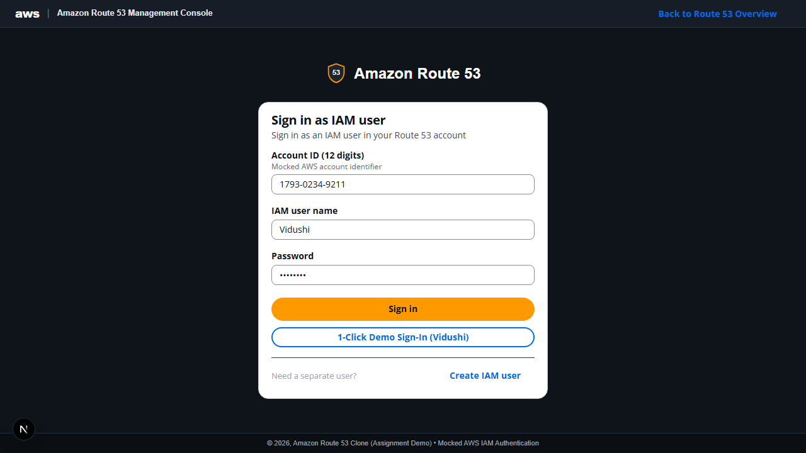
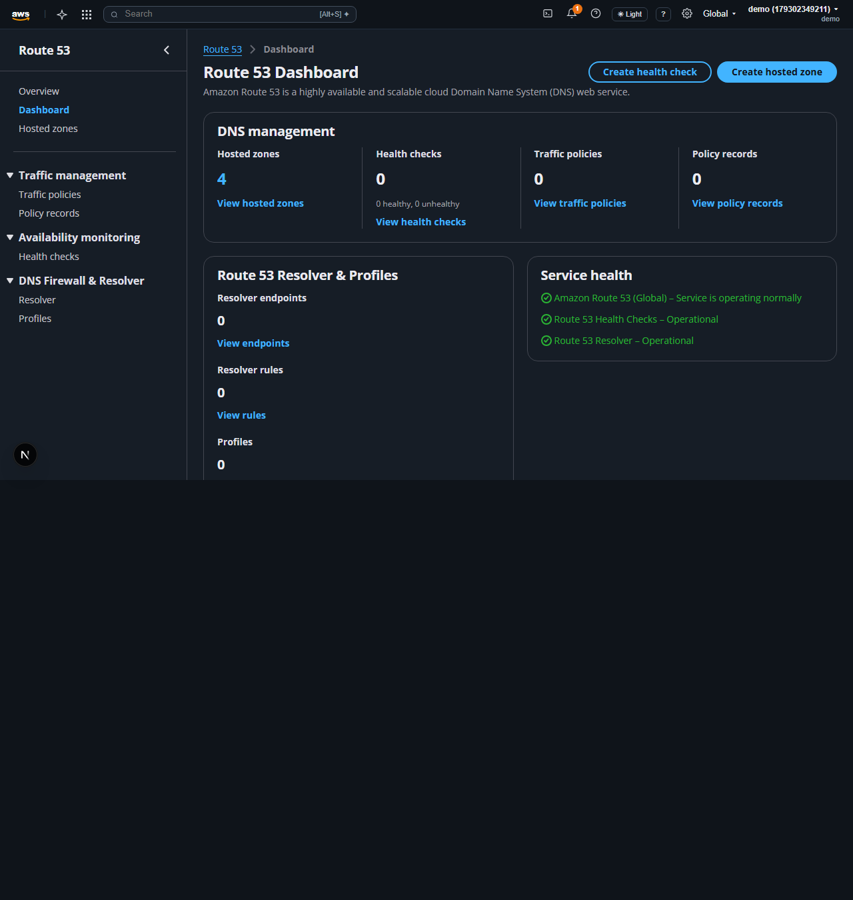
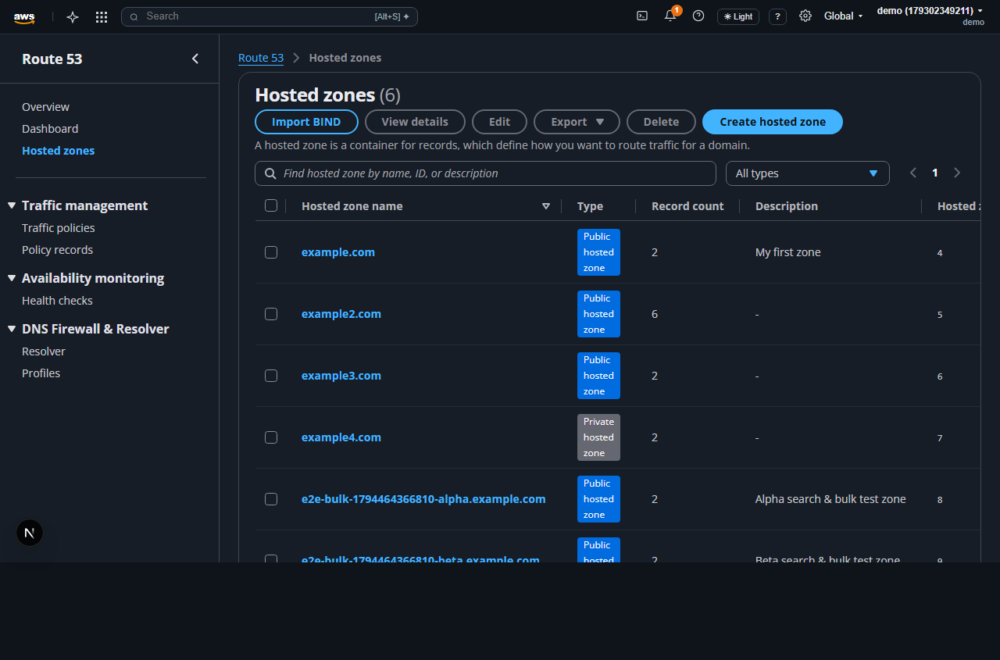
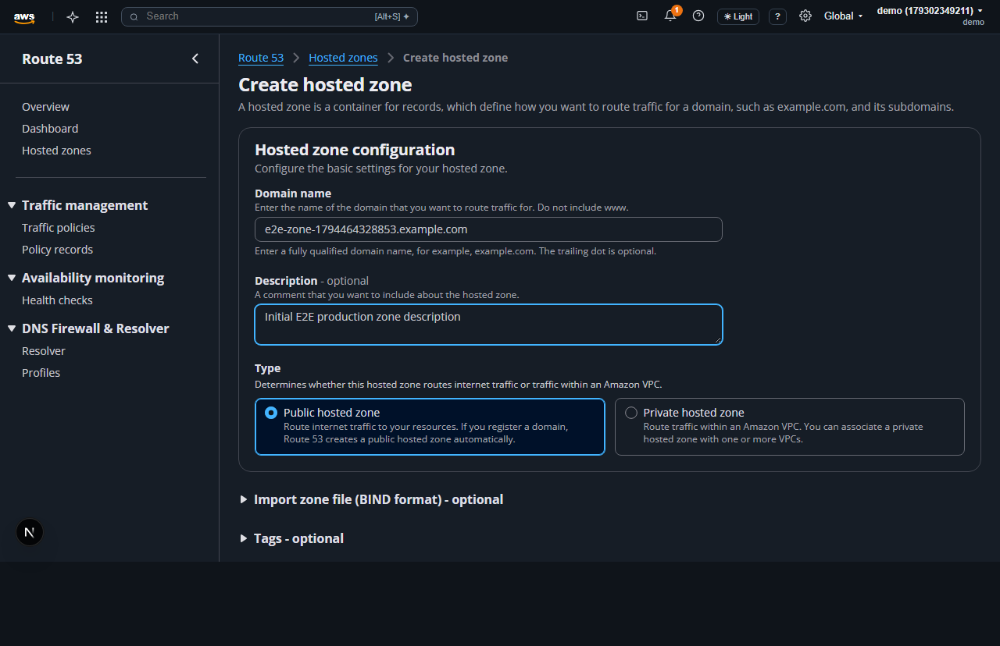
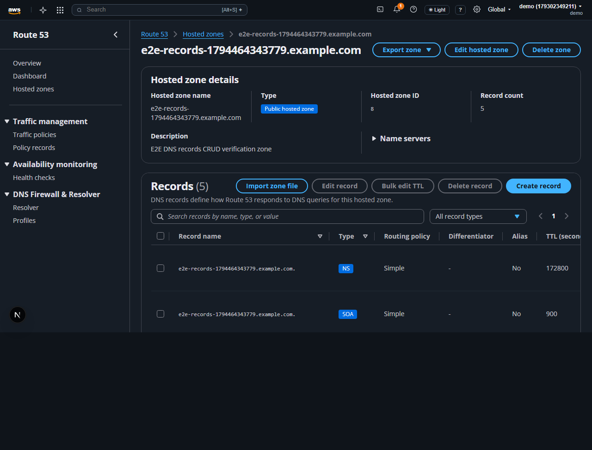
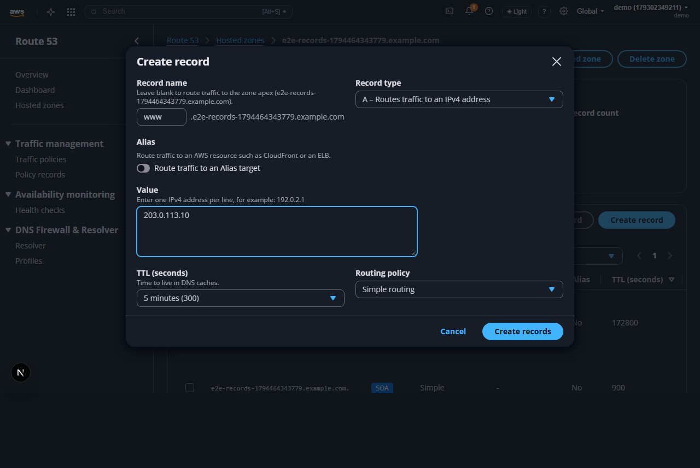
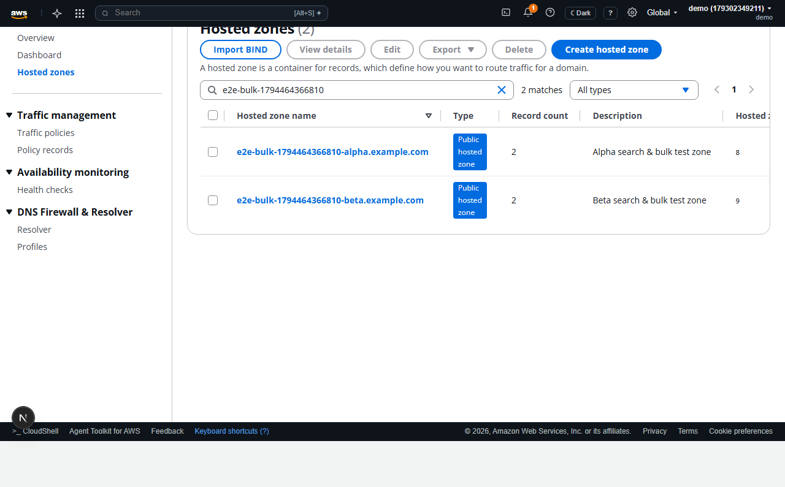
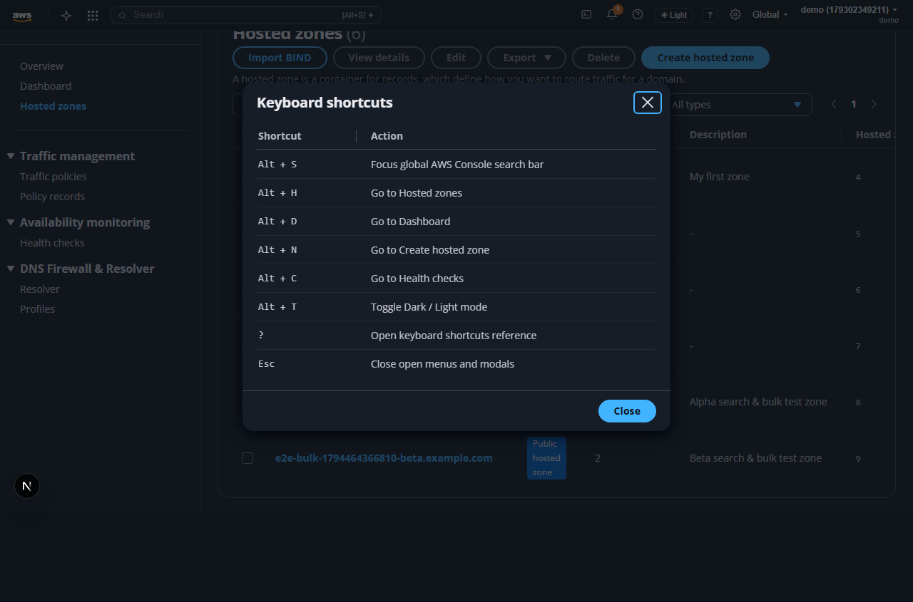

# User Walkthrough & Demo Credentials

This guide walks through every page of the **AWS Route 53 Clone** web console (`http://localhost:3000`) and lists the pre-configured demo credentials.

---

## Pre-Configured Demo Account Credentials

The backend automatically seeds a demo IAM user on first login or demo sign-in (`POST /auth/demo`).

| Field | Value | Notes |
| :--- | :--- | :--- |
| **AWS Account ID** | `1793-0234-9211` | Mocked 12-digit AWS account identifier |
| **IAM Username** | `Vidushi` | Also accepts `demo` as a login alias |
| **Password** | `demo1234` | Pre-filled on `/login` |
| **1-Click Demo Sign-In** | Click **1-Click Demo Sign-In (Vidushi)** | Calls `POST /auth/demo` and persists JWT in `localStorage` |

> [!TIP]
> You can also click **Create IAM user** on the sign-in form to register a separate isolated IAM user stored in SQLite.

---

## Page-by-Page Walkthrough

### 1. Route 53 Overview (`/`)
The public landing page mirrors the official Amazon Route 53 console overview:
- **Hero Banner**: Quick-launch buttons (**Get started** -> `/hosted-zones`, **Open Dashboard** -> `/dashboard`).
- **How it works**: Architecture diagram illustrating DNS Resolver/Client, Route 53 Shield, and Internet Users.
- **Products & Use Cases**: Direct links into Domain names, Hosted zones, Health checks, Traffic flow, and Resolver.

---

### 2. AWS IAM Sign-In (`/login`)
Protected console routes (`/dashboard`, `/hosted-zones`, etc.) automatically redirect unauthenticated visitors to `/login`.
- Enter your **Account ID**, **IAM user name**, and **Password**, or click **1-Click Demo Sign-In (Vidushi)**.
- Upon authentication, the top AWS console bar displays your active identity (`Vidushi (179302349211)`) with a **Sign out** option.

---

### 3. Route 53 Dashboard (`/dashboard`)
The Dashboard aggregates real-time counts across all Route 53 resources:
- **DNS management**: Total Hosted zones, Health checks (with healthy/unhealthy breakdown), Traffic policies, and Policy records.
- **Route 53 Resolver & Profiles**: Counts for Resolver endpoints, Resolver rules, and Profiles.
- **Service health**: Operational status indicators.
- **Hosted zones summary table**: Displays the 5 most recent hosted zones with quick links and record counts.

---

### 4. Hosted Zones List (`/hosted-zones`)
Manage all public and private hosted zones owned by the signed-in IAM user:
- **Search & Type Filter**: Filter zones in real time by domain name, zone ID, or description, and filter by `All types`, `Public hosted zone`, or `Private hosted zone`.
- **Single & Bulk Actions**:
  - **View details** / **Edit**: Inspect records or update the domain name and description.
  - **Import BIND**: Upload or paste a `.zone` file to import into an existing or newly created zone.
  - **Export**: Download single or multiple selected zones as **BIND (`.zone`)** or **JSON (`.json`)**.
  - **Delete**: Confirm single deletion by typing the domain name, or bulk delete multiple zones by typing `delete`.

---

### 5. Create Hosted Zone (`/hosted-zones/create`)
Create a new Public or Private hosted zone:
- Enter a **Domain name** (e.g., `example.com`) and optional **Description**.
- Choose **Public hosted zone** (internet traffic) or **Private hosted zone** (associate with an AWS Region and VPC ID).
- Optionally expand **Import zone file (BIND format)** to import records immediately on creation.
- Submitting automatically provisions 4 authoritative AWS `NS` name servers and an `SOA` apex record (initial record count = `2`).

---

### 6. Hosted Zone Details & DNS Records (`/hosted-zones/[zoneId]`)
Inspect zone metadata, copy authoritative name servers, and manage DNS records:
- **Hosted zone details**: Displays Hosted zone name, Type badge, Hosted zone ID, live **Record count**, Description, and expandable **Name servers** with one-click copy.
- **Records table**: Search by name/type/value, filter by record type (`A`, `AAAA`, `CNAME`, `MX`, `TXT`, `PTR`, `SRV`, `CAA`, `NS`, `SOA`), paginate, and edit or delete records.
- **Create / Edit Record Modal**: Supports Alias targets, TTL presets, and routing policies (`Simple`, `Weighted`, `Latency`, `Failover`, `Geolocation`, `Multivalue`) with optional Health Check association.
- **Bulk Operations & Protection**: Select multiple records for **Bulk edit TTL** or **Delete records**. Required apex `NS` and `SOA` records are protected from accidental deletion.

---

### 7. Supporting Route 53 Services
- **Health Checks (`/health-checks`)**: Create `HTTP`, `HTTPS`, or `TCP` monitors, run live endpoint probes, and view status reasons.
- **Traffic Policies (`/traffic-policies`) & Policy Records (`/policy-records`)**: Author versioned traffic flow JSON policies, increment policy versions, and bind policy records to hosted zones.
- **Resolver (`/resolver`) & Profiles (`/profiles`)**: Configure Inbound/Outbound VPC Resolver endpoints, forwarding rules, and reusable Route 53 Profiles across VPCs.

---

### 8. Console-Wide Productivity Features
- **Dark / Light Mode Toggle**: Click **☀ Light** / **☾ Dark** in the top console bar (or press `Alt+T`) to switch themes; preference persists in `localStorage`.
- **Keyboard Shortcuts**: Press `?` anywhere outside text inputs to open the shortcuts reference, or use `Alt+S` (global search), `Alt+D` (Dashboard), `Alt+H` (Hosted zones), `Alt+N` (Create zone), and `Alt+C` (Health checks).

